<!-- SPDX-FileCopyrightText: 2026 LabLog contributors -->
<!-- SPDX-License-Identifier: AGPL-3.0-only -->

# LabLog beta user guide

Welcome, and thank you for trying LabLog. LabLog is an amateur radio logger
that runs in your web browser. One LabLog server keeps the log for a whole
station or club, so several operators at several workstations log into the
same log at the same time. It also works with no internet at all.

This is a **first-round beta**. Most things work, some are rough, and a few
are not built yet. The section [What's not finished](#whats-not-finished)
lists what we know about. Please tell us about anything else.

Every time in LabLog is **UTC**.

## Getting in

brian (K9KSU) sets you up. He adds your email address to the list of
testers, makes you an account under **your own callsign**, and sends you a
**PIN** privately. Keep the PIN to yourself. There is nothing to install, so
a computer, tablet or phone all work.

1. Open **https://lablog.w0cy.com** in your browser.
2. A Cloudflare page asks for your email address. Type the address you gave
   brian. Cloudflare emails you a one-time code; type it in. Only the
   addresses brian listed get past this step.
3. You now see LabLog's own **Sign in**. Type your **callsign**, your
   **PIN**, and a **station** name. The station name says which position you
   are logging from; type `home`.
4. Click **Sign in**.

Your account can log and look things up. It can't run radios or change the
server's settings; those are for administrators.

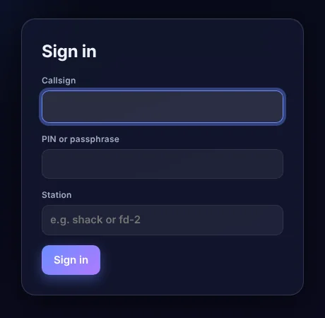

**Please log in a practice operation** (see [Operations](#operations-and-overlays)).
Practice QSOs never go to LoTW or QRZ.com, and they can be wiped after the
beta.

To leave, open **Menu** and click **Sign out** at the bottom.

## The page

The top bar shows LabLog, who you are and where (like `K9KSU at home`), and
**Menu**. Everything else is a set of boxes: New QSO, Station profile, Log,
maps, Operation stats and On air.

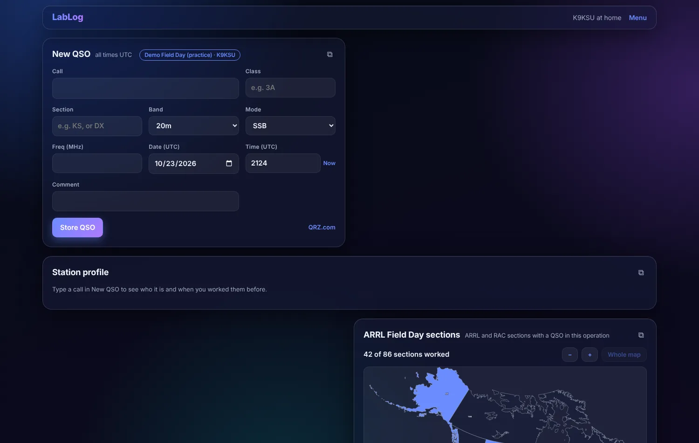

### Menu

**Menu** opens a short list of headings. Click one to open it:

- **Operation**: which operation you are logging in, setting one up, and
  importing an ADIF file.
- **Appearance and layout**: Auto, Light or Dark; unlocking the boxes to
  move them; choosing which boxes show.
- **Connections**: your QRZ.com lookup and logbook, LoTW, and the US and
  Canada call lists.
- **Admin**: only administrators see this.

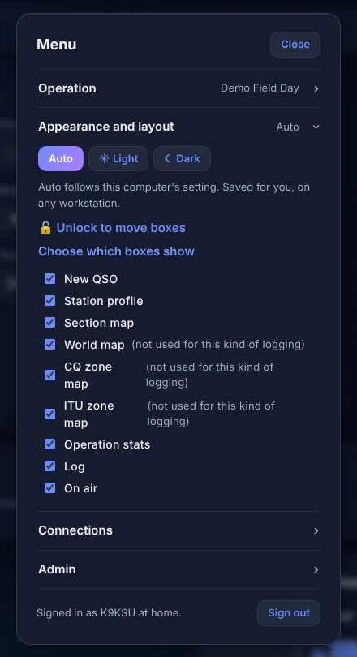

### Arranging the boxes

The layout is yours. It is saved with your callsign, so it follows you to
any computer you sign in on.

1. Open **Menu > Appearance and layout** and click **🔓 Unlock to move
   boxes**.
2. Each box now has a bar with a **⠿ handle**. Drag a box by it. Let go on
   the centre line for full width, or left or right of it for that side.
3. The width list on each bar sets a box to ¼, ⅓, ½, ⅔ or Full.
4. **Size** makes what is inside a box smaller or larger without changing its
   width. The **100%** button puts it back.
5. **Hide** takes a box off the page.
6. Click **🔒 Lock** when you're done. **Reset to default** starts over.

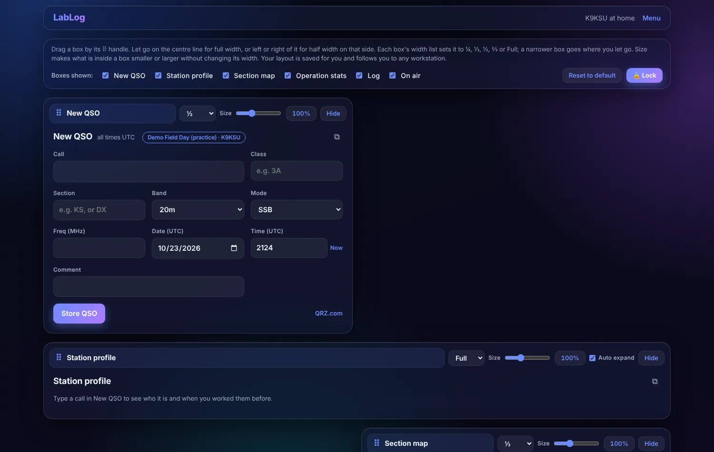

While unlocked, the bar at the top lists every box with a tick, so you can
hide and show them there too. When locked, open **Menu > Appearance and
layout > Choose which boxes show**.

### Boxes that fold

The Station profile, Log, Operation stats and On air can grow long, so they
keep a short part in view with a thin bar under it.

- Click the bar (or tap it on a tablet) to open the rest **over** the page.
  Nothing else on the page moves. It fades away when the pointer leaves.
- While it is open, the **🔓** on the bar locks it open in place, taking its
  room on the page. Click **🔒** to let it fold again. LabLog remembers this
  for you.
- With **Auto expand** ticked (on the box's bar while unlocked), a box opens
  by itself when your pointer rests in it. It starts off for the Log.

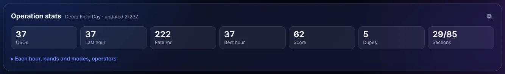

### Pop-outs

The **⧉** at the top right of a box opens it in a window of its own, to drag
onto a second screen. The main page then says the box is in its own window,
with **Bring it back**.

## Logging a QSO

The **New QSO** box is where you type.

1. Type the **Call**. Zeros show slashed (Ø) so they never look like the
   letter O.
2. **Tab** moves to the next box. In a contest the boxes follow the
   exchange, so Tab goes where you need to be next.
3. Date and time fill in for you. **Now** sets them to this moment, in UTC.
   Type a time as `1805`.
4. Press **Enter** or click **Store QSO**.

The QSO is in the log the moment the server saves it. There is no
"saved!" message; it simply appears at the top of the Log and the form
clears for the next one.

- **Esc** throws away a half-typed QSO and starts over.
- If the server can't be reached, a **Not logged yet** panel appears in the
  corner. Your browser keeps those QSOs and sends them by itself when it
  can; **Send now** tries straight away. Nothing is lost and nothing is
  logged twice. Don't close the browser's data while QSOs are waiting there.
- In a contest, a **dupe** shows a warning under the form. It is a warning:
  you can still store the QSO.

## Station profile

As you type a call, the **Station profile** box shows who it is:

- the name, QTH and other facts, from LabLog's own copy of the FCC and
  Canadian license lists first (these work with no internet), then from
  QRZ.com if you have set up a QRZ lookup;
- the operator's QRZ photo, and a **Biography** button that opens their QRZ
  biography in a large window;
- the **distance and heading** to them, worked out from the two grid
  squares (it says "from grid squares"). Click the distance to switch
  between miles and kilometres. Your own grid comes from your LoTW station
  location, or else from your own QRZ listing;
- every earlier QSO you have with that call.

Boxes you left empty in New QSO (name, QTH, state, grid) fill in from the
lookup. What you type always wins.

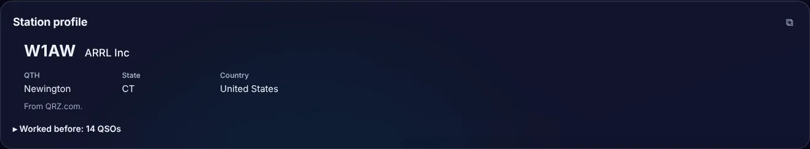

## The Log

The Log shows ten QSOs and scrolls inside its box.

- **My QSOs / Club QSOs**: slide the switch to see every operator's QSOs in
  this operation, not only yours.
- **Find a call** filters the list.
- **Columns** chooses which columns show (any ADIF field), and you can drag
  column headings to reorder them. Click a heading to sort.
- **Show deleted** shows QSOs that were deleted.
- The **✎ pencil** at the end of a row opens that QSO.

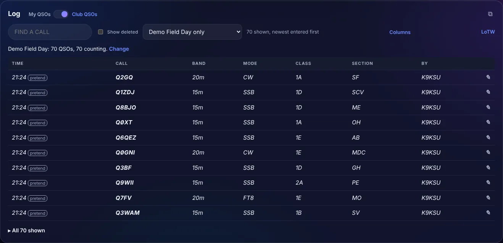

### Changing or deleting a QSO

The pencil opens the QSO over the page. Change any field, add a note saying
why, and click **Save as new version**. **Delete** and **Restore** are
there too. **Fields** chooses which fields the window shows.

LabLog never throws away a real QSO. Every change is a new version, and
**History** shows each version: who changed it, when, and what changed. A
deleted QSO can always be restored.

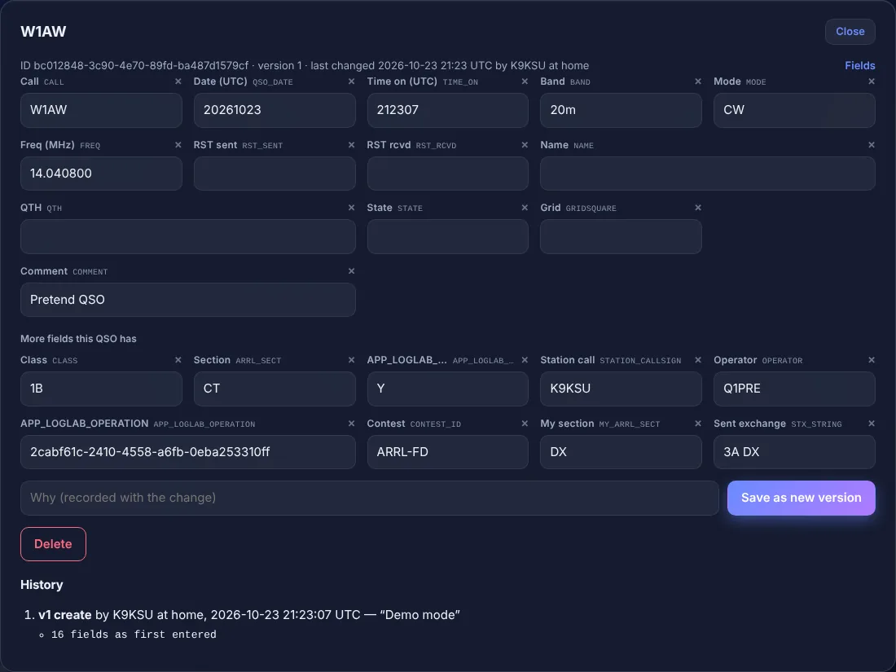

### Importing an ADIF file

**Menu > Operation > Import an ADIF file** brings in another program's log,
such as WSJT-X's `wsjtx_log.adi`. A QSO LabLog already has (same call, band
and mode in the same UTC minute) is left alone, so you can import the same
file again later and only the new QSOs come in. Every field in the file is
kept as it is.

While you are in an operation you choose whether the file's QSOs go into the
operation (only those made during its hours) or into the log with no
operation.

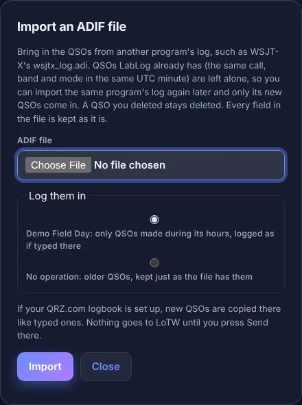

## Operations and overlays

An **operation** is one event or one way of logging: Field Day under a club
call, a weekend of Sweepstakes, or just everyday logging. An **overlay** is
the set of rules and the layout an operation uses. These overlays come with
LabLog:

| Overlay | What it sets up |
| --- | --- |
| Everyday logging | General logging, a world map with paths to your latest QSOs, no dupe check |
| ARRL Field Day | Class and section exchange, dupe check, section map, Field Day points |
| Winter Field Day | The same for WFD |
| ARRL Sweepstakes CW, Phone | The Sweepstakes exchange, dupe check, section map |
| CQ WW DX CW, SSB | CQ zone exchange, dupe check, CQ zone map |
| IARU HF World Championship | ITU zone exchange, dupe check, ITU zone map |

With no operation picked, you log everyday QSOs as your own call.

### Setting up a practice operation

1. **Menu > Operation > Set up an operation**.
2. Pick the **Overlay**, give it a **Name**, and use your own callsign as the
   **Station call**.
3. For a contest overlay, fill in what you send: for Field Day, your class
   (like `1D`) and section (like `KS`).
4. Give it UTC start and end times if you like. QSOs outside its hours are
   refused, so for testing, give it plenty of room.
5. **Tick Practice.** Practice QSOs never go to LoTW or QRZ.com. This can't
   be changed later.
6. **Save**. Pick it under **Log as** in the same Menu section.

The New QSO title then shows the operation's name, and the Log, maps and
stats show only that operation's QSOs. **Change or end this operation**
changes it or ends it.

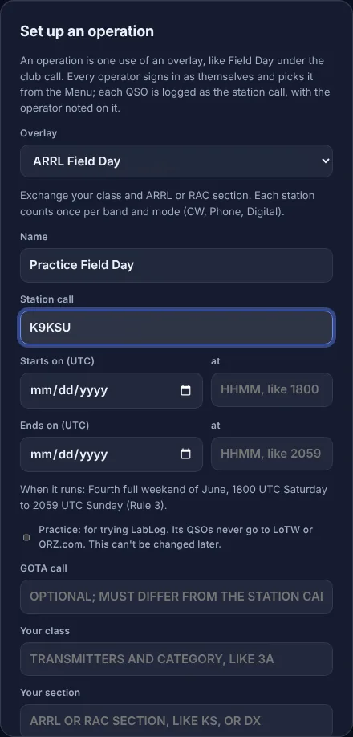

## Operation stats

In an operation, **Operation stats** shows tiles for total QSOs, the last
hour, the current rate, the score, dupes and sections worked. Open its bar for
an hourly chart, bands and modes, and each operator's totals. Every
workstation sees the same numbers. The score is QSO points only; power
multipliers and bonuses aren't counted yet.

With no operation picked (everyday logging), it shows your own stats instead:
your QSOs today, this week and this year (UTC; weeks start Monday), all
time, the US states and the countries you've worked. Open its bar for bands
and modes, the states (and, near the end, the ones you still need) and the
countries. States and countries come from each QSO's State, DXCC and Country
as logged; a QSO that names no country isn't counted, since LabLog doesn't
guess a country from the call.

If you don't see it, turn it on under **Menu > Appearance and layout >
Choose which boxes show**.

## On air

In an operation, **On air** lists who is on the air right now: operator,
station, band, mode and their last QSO. Two stations on the same band and
mode under the same call are marked, since Field Day allows one transmitter
per band and mode. Folded, it shows only your own row.

The band and mode shown are what each operator's New QSO box is set to, not
read from a radio (unless that station runs a Station Agent).

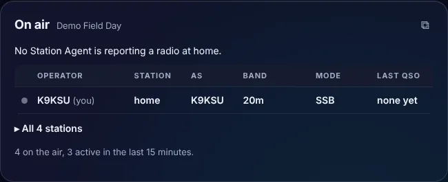

## Maps

Each overlay shows the maps its rules count:

- **Section map** (Field Day, Sweepstakes): ARRL and RAC sections worked in
  this operation, and a list of those still to work.
- **CQ zones** and **ITU zones**: the same, by zone.
- **World map** (Everyday): paths to your latest QSOs. Set how many with
  **Last N QSOs** (50 to start). A QSO needs a grid square to be drawn.

Tap a section, zone or path for details. Ctrl and the scroll wheel, or the
**+** and **−** buttons, zoom in; **Whole map** zooms back out.

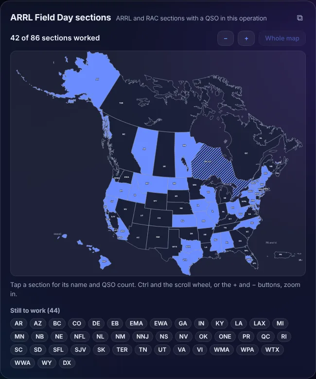

## Demo mode

Administrators can turn on **Demo mode**. Pretend operators then log pretend
QSOs in a practice operation called **Demo Field Day**, so every box has
something in it. Pretend QSOs are shown in *italic* and marked "pretend",
appear under **Club QSOs**, never upload anywhere, and are erased when Demo
mode is turned off. If you see them, that's what they are.

## QRZ.com

Open **Menu > Connections > QRZ.com lookup and logbook**. Both parts are
yours alone, and both are optional.

- **Callsign lookup**: your QRZ.com username and password. QRZ's lookup
  needs a QRZ XML subscription. Without one, US and Canadian calls still
  fill in from LabLog's own lists.
- **Your QRZ logbook**: your logbook's API key, from the logbook settings on
  QRZ.com. Each QSO you log from then on is copied to your QRZ logbook, and
  edits and deletes follow it. With no internet, QSOs wait and go out
  later; logging never waits for QRZ.

Please don't connect your QRZ logbook while you are testing with practice
QSOs you don't want there. (Practice QSOs are never sent, but everyday QSOs
are.)

## LoTW

Open **Menu > Connections > LoTW**, or the **LoTW** link on the Log.
LabLog never sends QSOs to LoTW as you log. LoTW can't change or delete a
QSO once it has it, so LabLog sends **batches** that you check first:

1. Under **Callsign certificate**, pick your `.p12` file. In TrustedQSL,
   choose your certificate and *Save the callsign certificate* to make one.
2. Fill in **Station location**: grid, state and county (or province), and
   zones.
3. Optionally, under **LoTW website login**, save your LoTW username and
   password. That is only used to fetch confirmations.
4. **Prepare a batch**. Check the QSOs in it. Nothing has gone yet.
5. **Send this batch to LoTW**, or **Cancel batch**.

**Fetch confirmations** brings back what LoTW has confirmed. **Past
batches** shows exactly what went in each one.

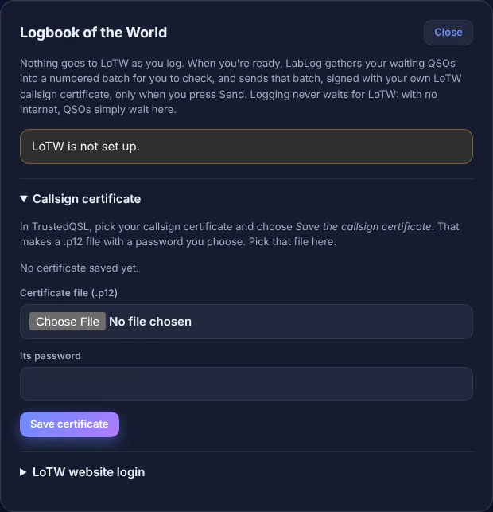

For the beta, we suggest you set up LoTW only if you want to try it with real
QSOs. Practice QSOs are never sent.

## WSJT-X

There are two ways to get WSJT-X QSOs into LabLog:

- **Import** WSJT-X's `wsjtx_log.adi` from **Menu > Operation > Import an
  ADIF file** whenever you like. Only new QSOs come in.
- **Live, through the Station Agent.** The Station Agent is a small LabLog
  program that runs on the computer with the radio. It reads the radio
  (frequency, band, mode) into New QSO and logs each QSO the moment you click
  **Log QSO** in WSJT-X. It has to be installed and approved by an
  administrator, so it's not part of the first beta round. If you want to
  try it, talk to brian.

## Reporting problems and ideas

Everything you notice helps, even small things. Send brian a note the way he
gave you, with:

1. what you were doing;
2. what you expected;
3. what happened instead;
4. the UTC time it happened, your callsign, and your browser (Chrome,
   Firefox, Safari, Edge) on what (Windows, Mac, iPad, phone);
5. a screenshot if you can.

Ideas and "this is confusing" are just as welcome as bugs.

## What's not finished

These are known. You don't need to report them, but tell us if one gets in
your way.

- **Other workstations' QSOs don't appear by themselves** in your Log or
  maps. Reload the page to see them. (Operation stats and On air do update on
  their own.)
- **Scores** are QSO points only: no power multiplier and no bonus points.
- **Radios**: the Station Agent only reads radios; it never tunes or
  transmits. It has been tried with Hamlib radios; a real FlexRadio has not
  been tested yet. It's not part of this beta round.
- **Phones**: LabLog is laid out for a computer or tablet. A phone works but
  is cramped.
- **No Cabrillo export** for contest submissions yet. ADIF export isn't in
  the web page yet either.
- The beta server is a test machine. Its log may be reset, so don't make
  it the only copy of real QSOs.
- Tablet taps for folding boxes are new and haven't had much use.
